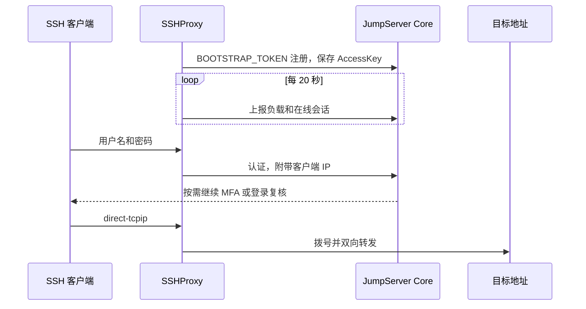

# JumpServer SSHProxy

SSHProxy 是 [JumpServer](https://github.com/jumpserver/jumpserver) 的 SSH 隧道组件。jumpserver的 koko 组件不支持端口转发, 此组件目标是为解决转发连接内网的需求, 并借助 jumpserver 账号和mfa认证体系做登录认证, 且可以在jumpserver管理后台查看活跃的会话.


## 功能

- 默认监听1024端口, 支持 `ssh -L` 和 `ssh -D` 的转发请求
- 使用 JumpServer 账号认证体系，并支持 MFA 认证功能
- 向 Core 注册组件信息, 定时上报组件状态
- 认证成功后, 会调用 Core 接口创建会话, 可在管理后台查看和管理已建立的连接

## 工作方式



## 环境要求

- Linux
- Docker, Docker Compose
- 构建镜像时，本机需要 Go 1.27 或更高版本

## 快速开始

拉取代码并构建镜像
```shell
git clone https://github.com/hsl727261250/jumpserver-sshproxy.git
cd jumpserver-sshproxy/docker
./build.sh
```
以上命令会构建一个名为 `jumpserver-sshproxy:latest` 的镜像

准备配置文件
```shell
mkdir -p /opt/jumpserver-sshproxy
cp jumpserver-sshproxy/config_example.yml /opt/jumpserver-sshproxy/config.yml
cp jumpserver-sshproxy/example.env /opt/jumpserver-sshproxy/.env
cp jumpserver-sshproxy/docker-compose.yml /opt/jumpserver-sshproxy/docker-compose.yml
```

### 修改配置文件

`.env` 文件需要修改以下配置

| 变量 | 模板值 | 作用 |
| --- | --- | --- |
| `SSHPROXY_IMAGE` | `jumpserver-sshproxy` | 镜像名或仓库地址 |
| `SSHPROXY_VERSION` | `latest` | 镜像版本 |
| `SSHPROXY_PORT` | `1024` | 宿主机映射端口，容器内固定监听 1024 |
| `SSHPROXY_NETWORK` | `jumpserver` | Core 所在的 Docker 网络, 一般jumpserver的网卡名都为`jms_net` |
| `SSHPROXY_DATA_DIR` | `/opt/jumpserver-data/sshproxy/data` | 日志等数据目录，挂到容器内 `/opt/sshproxy/data` |
| `CORE_HOST` | `http://core:8080` | JumpServer Core 地址,如果启动在同一网卡上,可通过域名访问core服务 |
| `BOOTSTRAP_TOKEN` | 空 | 请求core接口需要的令牌,从jumpserver的data下的config.txt文件中查找 |


config.yml 修改以下配置

| 配置 | 模板值 | 作用 |
| --- | --- | --- |
| `NAME` | 不填 | 向 Core 注册时使用的名称。不填则按主机名生成，前缀为 `[SSHProxy]-` |
| `LOG_LEVEL` | `INFO` | `DEBUG`、`INFO`、`WARN`、`ERROR` |
| `HTTP_REQUEST_TIMEOUT` | `30` | 调用 Core 的超时时间，单位秒 |
| `TERMINAL_TYPE` | `koko` | 注册到 Core 的终端类型 |
| `FORWARD_DIAL_TIMEOUT` | `15` | `direct-tcpip` 拨号超时，单位秒 |
| `MAX_IDLE_MINUTES` | `30` | 没有转发流量时断开，单位分钟。`0` 表示不限制 |
| `MAX_SESSION_HOURS` | `24` | 单条 SSH 连接的最长时间，单位小时。`0` 表示不限制 |
| `ASSET_ID` | 不填 | 创建 Core 会话使用的资产 ID。为空则不创建会话,后台无法查到活跃会话;填写一个有效的资产id,则在会话管理处会将所有隧道都记录到此资产上;资产id错误时,可正常使用,但无法管理会话 |


## 客户端
例如, 在datagrip中使用隧道时, 可以正常唤醒opt验证码输入

这里填入jumpserver的用户名和密码


初次进行连接时,或者认证过期时,有消息卡片弹出需要验证码, 点击 `Entry Password`, 输入验证码即可使用


