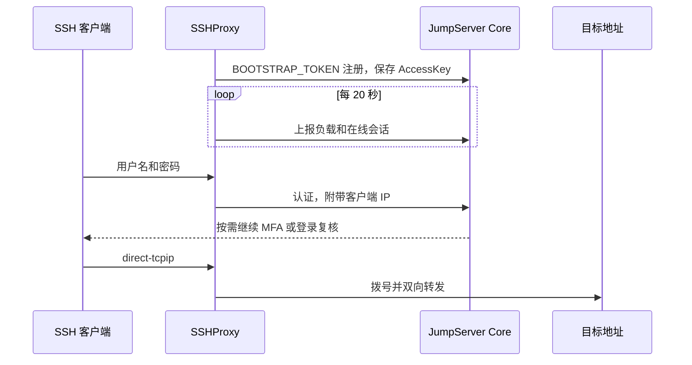

# JumpServer SSHProxy

SSHProxy 是 [JumpServer](https://github.com/jumpserver/jumpserver) 的 SSH 隧道组件。jumpserver的 koko 组件不支持端口转发, 此组件目标是为解决转发连接内网的需求, 并借助 jumpserver 账号和mfa认证体系做登录认证, 且可以在jumpserver管理后台查看活跃的会话.

账号开启 MFA 时，组件通过 SSH keyboard-interactive 继续收取 OTP、短信或邮件验证码。登录复核开启时，连接会停在提示处，直到管理员确认。交互式 Shell 和 SFTP 不可用。

## 功能

- 默认监听1024端口, 支持 `ssh -L` 和 `ssh -D` 的转发请求
- 使用 JumpServer 账号认证体系，并支持 MFA 认证功能
- 向 Core 注册组件信息, 定时上报组件状态
- 认证成功后, 会调用 Core 接口创建会话, 可在管理后台查看和管理已建立的连接

## 工作方式



Core 目前没有单独的 `sshproxy` 终端类型，注册时默认使用 `koko`。状态上报走这个类型下的独立组件。

配置了 `ASSET_ID` 时，认证成功会创建一条协议为 `proxy`、类型为 `tunnel` 的会话。心跳的 `sessions` 带上这条会话的 ID。连接断开、空闲超时或达到最长会话时间后，会话被标为结束。管理员在审计页终止会话时，下一次心跳带回 `kill_session`，组件关闭对应的 SSH 连接。`ASSET_ID` 为空时只上报本进程里的连接数，`sessions` 为空，不会写成 Core 会话。其他终端任务会被忽略。会话 ID 只保存在内存中，进程退出后丢失。

创建 Core 会话失败时，SSH 连接仍然可用，Core 里没有对应审计记录。资产需要位于组件服务账号的默认组织。

## 环境要求

- JumpServer Core 允许组件注册，且 `BOOTSTRAP_TOKEN` 与 Core 配置一致
- Docker 与 Docker Compose
- 构建镜像时，本机需要 Go 1.27 或更高版本，以及本地镜像 `debian:trixie-slim`

## 快速开始

`docker/.env` 和仓库根目录的 `config.yml` 已在 `.gitignore` 中，按模板复制后再改：

```bash
cp docker/example.env docker/.env
cp config_example.yml config.yml
mkdir -p /opt/jumpserver-data/koko/data
```

部署前至少确认这几项：

| 项 | 文件 | 说明 |
| --- | --- | --- |
| `SSHPROXY_NETWORK` | `docker/.env` | Core 已经加入的 Docker 网络。不存在时先执行 `docker network create jumpserver` |
| `CORE_HOST` | `docker/.env` | 容器在该网络中访问 Core 的地址，例如 `http://core:8080` |
| `BOOTSTRAP_TOKEN` | `docker/.env` | 与 Core 配置一致。AccessKey 写入数据目录后可以留空 |
| `SSHPROXY_DATA_DIR` | `docker/.env` | 宿主机数据目录，默认 `/opt/jumpserver-data/koko/data` |
| `ASSET_ID` | `config.yml` | 可选。填写后才会在 Core 中创建隧道会话 |

在 `docker` 目录构建并启动。Compose 使用已经打好的本地镜像，启动时不会重新构建：

```bash
cd docker
./build.sh
docker compose up -d
docker compose logs -f sshproxy
```

容器设置了 `CORE_HOST` 后，入口脚本会轮询 `${CORE_HOST}/api/health/`，成功后再启动进程。日志中出现 `Start SSH server at 0.0.0.0:1024` 即表示 SSH 端口已经开始监听。注册失败时容器退出。先核对 Token、Core 是否允许注册，以及 `CORE_HOST` 能否从 `SSHPROXY_NETWORK` 访问到。

## 构建

`docker/build.sh` 会：

1. 读取 `docker/.env`。文件不存在时改读 `docker/example.env`
2. 在仓库根目录编译 Linux amd64 二进制 `sshproxy`（`CGO_ENABLED=0`）
3. 以仓库根目录为构建上下文执行 `docker build`，标签为 `${SSHPROXY_IMAGE}:${SSHPROXY_VERSION}`

`go build` 使用本机已有的模块缓存。镜像内不安装 Go，也不在镜像里编译。脚本不登录镜像仓库，也不推送镜像。`docker build` 使用本地的 `debian:trixie-slim`，构建时把 apt 源换成阿里云镜像站，再安装 `ca-certificates` 和 `curl`。

镜像工作目录是 `/opt/sshproxy`，对外端口是 `1024`，数据卷是 `/opt/sshproxy/data`。复制进镜像的文件只有根目录的 `sshproxy`、`docker/entrypoint.sh` 和 `config_example.yml`。根目录的 `sshproxy` 二进制已被 `.gitignore` 忽略。

使用仓库中的镜像时，把 `docker/.env` 里的 `SSHPROXY_IMAGE` 和 `SSHPROXY_VERSION` 改成仓库地址和版本，例如 `registry.example.com/jumpserver-sshproxy` 和 `v1.0.0`，然后直接 `docker compose up -d`。

## 配置

进程读取的环境变量是 `CORE_HOST` 和 `BOOTSTRAP_TOKEN`。启动时先加载 `config.yml`，再用这两个变量覆盖文件中的同名项。SSH 监听地址固定为 `0.0.0.0:1024`，可用 `-f` 指定配置文件路径。

### Compose

`docker/docker-compose.yml` 只引用同目录的 `.env`，并把仓库根目录的 `config.yml` 只读挂到 `/opt/sshproxy/config.yml`。

| 变量 | 模板值 | 作用 |
| --- | --- | --- |
| `SSHPROXY_IMAGE` | `jumpserver-sshproxy` | 镜像名或仓库地址 |
| `SSHPROXY_VERSION` | `latest` | 镜像版本 |
| `SSHPROXY_PORT` | `1024` | 宿主机映射端口，容器内固定监听 1024 |
| `SSHPROXY_NETWORK` | `jumpserver` | Core 所在的 Docker 网络 |
| `SSHPROXY_DATA_DIR` | `/opt/jumpserver-data/koko/data` | 宿主机数据目录，挂到容器内 `/opt/sshproxy/data` |
| `CORE_HOST` | `http://core:8080` | JumpServer Core 地址，传入进程 |
| `BOOTSTRAP_TOKEN` | 空 | 首次注册使用的预共享密钥，传入进程 |

### config.yml

| 配置 | 模板值 | 作用 |
| --- | --- | --- |
| `NAME` | 不填 | 向 Core 注册时使用的名称。不填则按主机名生成，前缀为 `[SSHProxy]-` |
| `LOG_LEVEL` | `INFO` | `DEBUG`、`INFO`、`WARN`、`ERROR` |
| `HTTP_REQUEST_TIMEOUT` | `30` | 调用 Core 的超时时间，单位秒 |
| `TERMINAL_TYPE` | `koko` | 注册到 Core 的终端类型 |
| `FORWARD_DIAL_TIMEOUT` | `15` | `direct-tcpip` 拨号超时，单位秒 |
| `MAX_IDLE_MINUTES` | `30` | 没有转发流量时断开，单位分钟。`0` 表示不限制 |
| `MAX_SESSION_HOURS` | `24` | 单条 SSH 连接的最长时间，单位小时。`0` 表示不限制 |
| `ASSET_ID` | 不填 | 创建 Core 会话使用的资产 ID。为空则不创建会话 |

## 客户端

把 `proxy.example.com` 换成 SSHProxy 的地址，端口换成 `SSHPROXY_PORT`，`alice` 换成 JumpServer 用户名。

转发单个 TCP 端口：

```bash
ssh -p 1024 -N -L 127.0.0.1:15432:10.0.0.8:5432 alice@proxy.example.com
```

作为本地 SOCKS 代理：

```bash
ssh -p 1024 -N -D 127.0.0.1:1080 alice@proxy.example.com
```

账号开启 OTP 时，客户端会继续提示输入验证码。有多种 MFA 方式时，先选择序号，再输入验证码。短信和邮件会先向 Core 发起挑战。登录复核开启后，按提示等待管理员确认；回答 `n` 会取消本次复核。人脸验证不在可选列表中。

直接打开交互式会话时，服务端返回 `shell is disabled` 并断开。`ssh -R` 和 SFTP 会被拒绝。

## 数据目录

Compose 把 `SSHPROXY_DATA_DIR` 挂到容器内 `/opt/sshproxy/data`。目录中会生成：

| 路径 | 作用 |
| --- | --- |
| `keys/ssh_host_ed25519_key` | SSH 主机密钥。丢失后客户端会提示主机指纹变化 |
| `keys/.access_key` | 注册得到的 AccessKey。文件存在时不再注册 |
| `logs/sshproxy.log` | 运行日志 |

升级时重新构建镜像并重建容器，这个目录会保留：

```bash
cd docker
./build.sh
docker compose up -d
```

确认要重新注册时，再删除其中的 `keys/.access_key`，并重新提供有效的 `BOOTSTRAP_TOKEN`。

## 本地运行

不使用容器时，在仓库根目录准备配置后直接运行。数据会写到当前目录的 `data/`：

```bash
cp config_example.yml config.yml
export CORE_HOST=http://127.0.0.1:8080
export BOOTSTRAP_TOKEN=your-token
go run ./cmd/sshproxy -f config.yml
```

查看编译信息：

```bash
go run ./cmd/sshproxy -V
```
